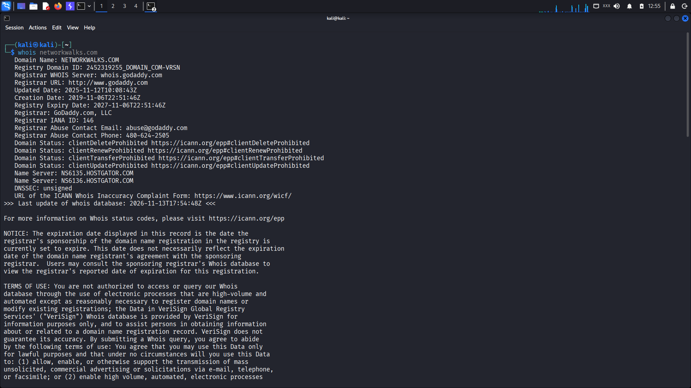
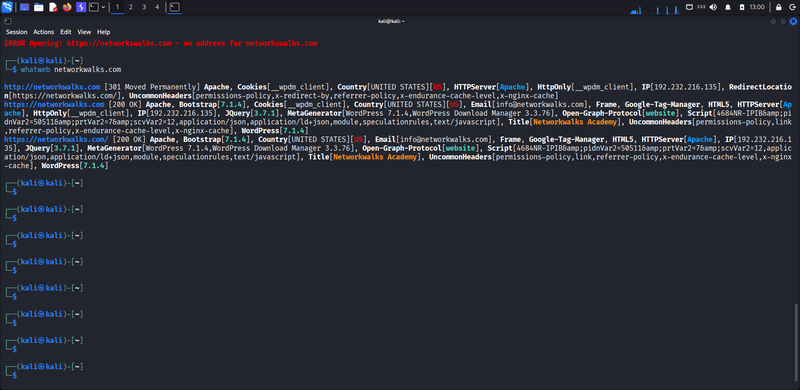
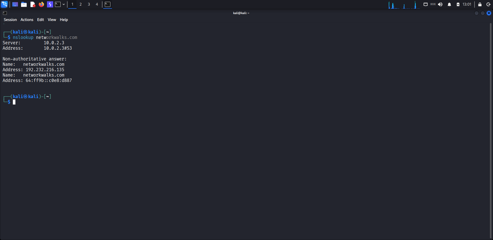
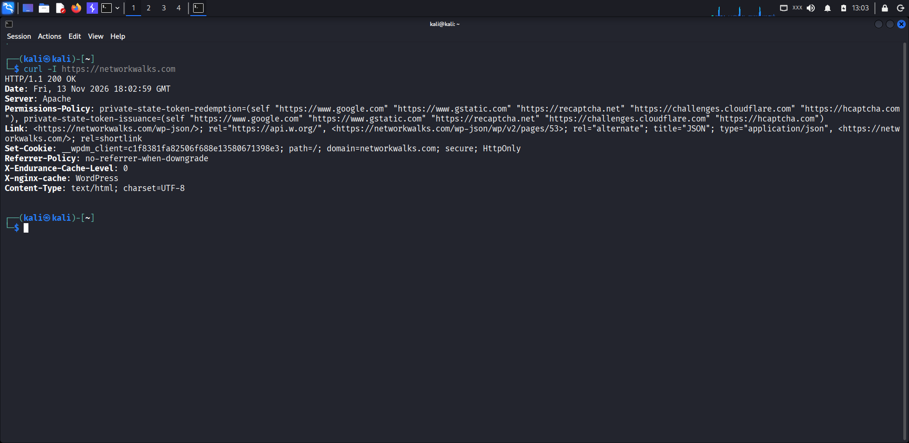
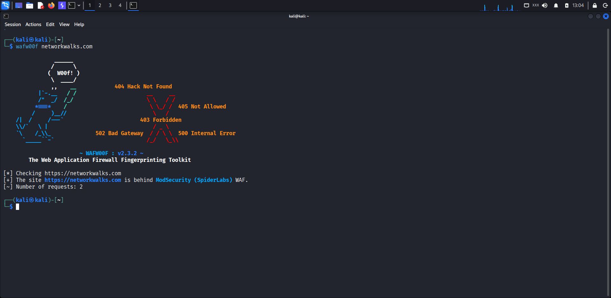
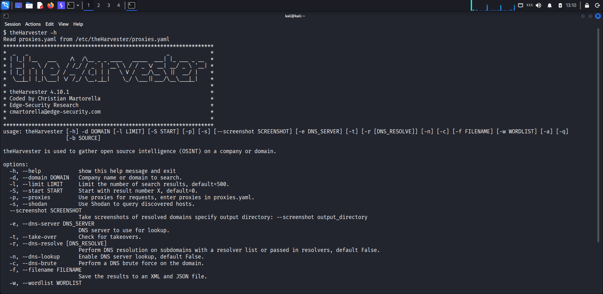
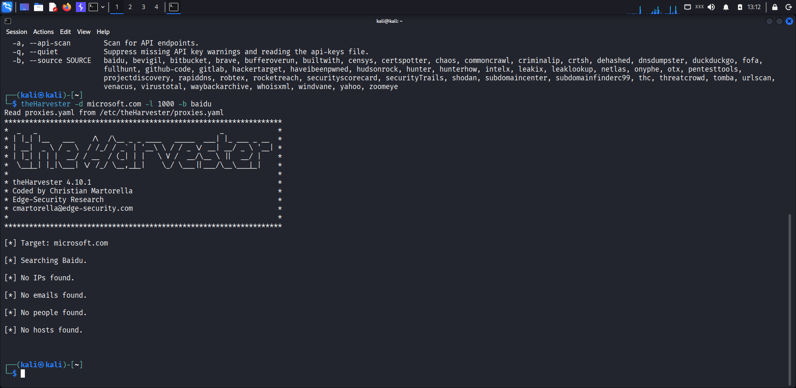
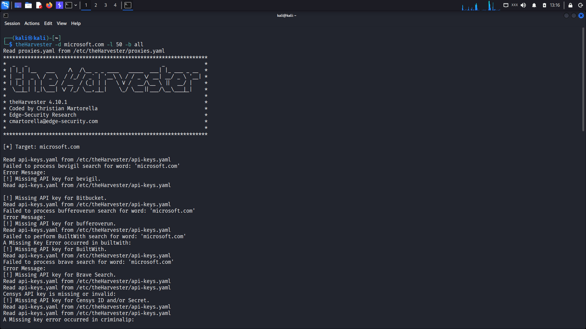

# Networkwalks-Internship-week-2-

**Author:** Sanika Sanjay Kale\
**Program:** Networkwalks -- Cybersecurity & Ethical Hacking\
**Batch:** B084\
**Week:** 2

## Project Overview

This repository documents the practical activities completed during Week
2 of the Networkwalks Cybersecurity & Ethical Hacking program. The work
covers two modules focused on footprinting and reconnaissance:

-   **W2-PM1 -- Footprinting & Reconnaissance with Multiple Kali Tools**
-   **W2-PM4 -- Footprinting & Reconnaissance with theHarvester**

The exercises introduce methods for reviewing publicly available domain
information and collecting publicly available email, host, and
sub-domain information. They are learning activities intended to build a
foundation in cybersecurity reconnaissance and defensive awareness.

## Objectives

-   Understand the role of footprinting and reconnaissance in a
    cybersecurity assessment.
-   Practise using common Kali Linux tools to examine public domain,
    DNS, HTTP, and web-technology information.
-   Use theHarvester with different information sources and result
    limits.
-   Capture terminal screenshots and save command output as practical
    evidence.
-   Understand how defenders can review and reduce unnecessary public
    information exposure.

## Modules and Tasks

### W2-PM1 -- Multiple Kali Linux Tools

The lab uses the following tools against `networkwalks.com`:

  ------------------------------------------------------------------------------------
  Tool                    Command                              Purpose
  ----------------------- ------------------------------------ -----------------------
  WHOIS                   `whois networkwalks.com`             Review public domain
                                                               registration
                                                               information and name
                                                               servers.

  WhatWeb                 `whatweb networkwalks.com`           Identify website
                                                               technologies and
                                                               technology
                                                               fingerprints.

  Nslookup                `nslookup networkwalks.com`          Resolve the domain name
                                                               through DNS.

  Curl                    `curl -I https://networkwalks.com`   Inspect HTTP response
                                                               headers.

  Wafw00f                 `wafw00f networkwalks.com`           Check for indications
                                                               of a Web Application
                                                               Firewall (WAF).

  DNSRecon                `dnsrecon -d networkwalks.com`       Enumerate available DNS
                                                               record information.
  ------------------------------------------------------------------------------------

### W2-PM4 -- theHarvester

The lab uses theHarvester to collect publicly available information
related to `microsoft.com`.

**Task 1 -- Baidu source (limit 1000)**

``` bash
theHarvester -d microsoft.com -l 1000 -b baidu
```

**Task 2 -- All supported sources (limit 50)**

``` bash
theHarvester -d microsoft.com -l 50 -b all
```

The information returned can vary depending on source availability and
changes to those sources. Results from one run may differ from another.

## Tools and Environment

-   Kali Linux
-   WHOIS
-   WhatWeb
-   Nslookup
-   Curl
-   Wafw00f
-   DNSRecon
-   theHarvester

## Evidence
Screenshots collected as evidence during the activities (stored in the screenshots/ folder):









## Key Learning Outcomes

-   Gained familiarity with common Kali Linux reconnaissance tools and
    their command-line usage.
-   Learned how WHOIS and DNS utilities can reveal public domain and
    infrastructure information.
-   Practised identifying web technologies and reviewing HTTP response
    headers.
-   Learned how WAF identification and DNS enumeration contribute to an
    initial technical profile.
-   Practised collecting publicly available email and host information
    using theHarvester.
-   Understood the importance of documenting findings and interpreting
    them carefully.

## Responsible Use and Disclaimer

This repository is for educational and research purposes only. Perform
reconnaissance only on systems and domains that you own, control, or
have explicit permission to assess. Follow the scope and rules provided
by the relevant instructor or system owner.

Reconnaissance findings are observations, not proof of vulnerabilities.
The activities documented here do not claim exploitation, unauthorized
access, or vulnerability validation. The author is not responsible for
misuse of the information or commands in this repository.

## Author

**Sneha Malyal**\
Networkwalks Cybersecurity & Ethical Hacking Program\
**Batch:** B084 \| **Week:** 2
